<p align="center">
  <picture>
    <source media="(prefers-color-scheme: dark)" srcset="docs/images/pajoniiir-logo-white.svg">
    <source media="(prefers-color-scheme: light)" srcset="docs/images/pajoniiir-logo-black.svg">
    
  </picture>
</p>

# Pajoniiir

[](https://github.com/dvucinozd/Pajoniiir/releases/latest)
[](https://www.espressif.com/en/products/socs/esp32-p4)
[](LICENSE)


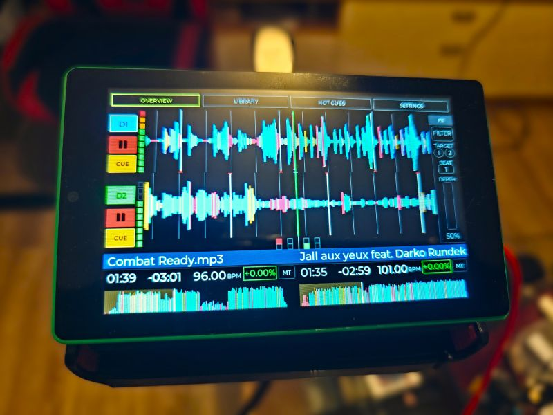

**A standalone dual-deck DJ system powered by one ESP32-P4.**

Pajoniiir plays a Rekordbox-exported USB library without a laptop. The P4
hosts the USB drive and DJ controller, renders the touchscreen UI, runs both
playback decks and DSP mixer, and provides MAIN and headphone-cue audio.

One shared firmware core serves the Guition **JC4880P443C_I_W**,
**JC1060P470C_I_W_Y** and **JC-ESP32P4-M3-DEV** boards. The M3 reference build
uses an **EYOYO 5-inch DSI506 touchscreen**.

Read the **[online user manual](https://docs.pajoniiir.eu/)** for setup,
controls and update instructions.

- No PC is required during a performance.
- MP3, WAV and FLAC playback is supported.
- Two independent decks provide waveforms, tempo control, Master Tempo,
  Hot Cues, loops, Beat Jump, Sync, Pad FX and Beat FX.
- MAIN audio is available on the PCM5102A RCA output.
- Headphone cue is returned through the selected supported USB controller.
- Signed local and remote OTA updates are supported.

## Supported DJ controllers

Support depends on the controller profile, board and firmware configuration.
The table distinguishes tested functions from profiles awaiting hardware checks.

| DJ controller | Support status | Audio and setup | Coverage and limits |
| --- | --- | --- | --- |
| [Pioneer DDJ-FLX4](docs/DDJ_FLX4_MIDI_MAP.md) | Reference controller; stable JC4880 support and accepted beta2 M3/JC4880 image scopes | USB MIDI/LED feedback and UAC1 headphone cue; ordinary port policy | Transport, mixer, jogs, pads, loops and effects. Exact board/image qualification and remaining gates are recorded separately. |
| [Hercules DJControl Inpulse 500](controllers/hercules_djcontrol_inpulse_500/README.md) | Beta support; tested on M3 and JC4880 | USB MIDI/LED feedback, UAC1 headphones and native headphone Mix/Volume; M3 requires the experimental USB port swap | M3 exact-image hour and JC4880 short functional blocks accepted. Individual pad/FX/LED coverage remains partial; controller RCA MAIN is unqualified. |
| [Native Instruments Traktor Kontrol S2 MK3](controllers/ni_traktor_s2_mk3_full/README.md) | Experimental M3 support; operator-closed with explicit waivers | MIDI mode, shared MIDI/LED profile and HS UAC2 headphones; controller USB3 / storage USB2 | Historical exact-image 48/44.1-kHz hours accepted. Remaining checks were waived, not passed; other boards are unqualified. |
| [Pioneer DDJ-400](controllers/pioneer_ddj_400/README.md) | Software profile available; canonical-image hardware acceptance NOT RUN | Shared MIDI/LED and USB audio implementation | Loop halve/double and memory store/delete included; memory actions require matching post-beta2 firmware. Scoped contributor testing is recorded separately; new-image qualification is pending. |
| [Numark DJ2GO2 Touch](controllers/numark_dj2go2_touch/README.md) | Software profile; repaired-image hardware acceptance NOT RUN | MIDI/LED, latching PFL levels and focused FS UAC1 contract | Requires newer firmware than published beta2; native/software level interaction and remaining LED/pad coverage need qualification. |

The [Numark DJ2GO2 Touch profile](controllers/numark_dj2go2_touch/README.md) is
available for software testing with firmware containing the latching-PFL
integration. Its new absolute-PFL mapping requires newer firmware than the
published beta2 images; repaired-image hardware qualification remains NOT RUN.
The disabled [new UI prototype](firmware/p4-core/components/ui_next/README.md)
uses demo data and is not selected by any production target.

[JC8012 integration preparation](firmware/boards/jc8012p4a1/README.md) provides
a private PPA preparation tool. The board remains inactive while touch firmware
distribution is unresolved; a published panel-table candidate is documented in
the [source audit](docs/reviews/2026-10-19-jc8012-source-audit.md). The separate
[JC1060 SD cold-power experiment](firmware/boards/jc1060/SD_COLD_POWER_EXPERIMENT.md)
is opt-in and OFF in production, pending exact-board hardware acceptance.

FLX4 remains the ordinary reference controller. M3 Hercules/S2 testing uses an
**explicit experimental port swap: controller USB3, storage USB2**; the ordinary
beta M3 download retains FLX4 on USB2 and storage on USB3. Select a matching
firmware configuration before activating a profile. S2 work is closed by
operator decision with remaining checks waived.

A JC4880 club-use report of low FLX4 headphone volume led to a
[headphone-level correction](docs/validation/FLX4_HEADPHONE_LEVEL_20261018.md),
accepted in JC4880 and M3 bench listening/control tests. The correction is
included in **shared-p4-beta.2**; stable M2.5 retains its original behavior.
Start headphone LEVEL low after updating and raise it gradually.

The release also includes a limited S2 basic profile and a generic MIDI-CI
fixture for development. They are not additional hardware-qualified DJ models.
A historical hour soak qualifies only its exact image and configuration;
it does not qualify newly built beta assets.

## Releases

### Stable: JC4880 / DDJ-FLX4

The current release for **JC4880 + DDJ-FLX4** is
[`M2.5`](https://github.com/dvucinozd/Pajoniiir/releases/tag/M2.5),
also available through the [public OTA channel](https://ota.pajoniiir.eu/latest.json).
It retains the previous UI design and includes the integrated library and
transport improvements.

JC1060, DDJ-400 and Ethernet Pro DJ Link are implemented as development
configurations. Their physical qualification is still pending. Recording and
SD storage experiments remain disabled in regular builds.

The [JC1060/DDJ-400 contributor review](docs/reviews/2026-10-14-jc1060-contributor-review.md)
records Kayrosen's scoped tests on a separate branch, including long Observe
and listening evidence. Integration repairs and failed storage/reconnect gates
remain open; these results do not qualify the published beta or a new image.

The [release record](docs/validation/M2_5_RELEASE_20261006.md) documents
the tested configuration, explicit final-image soak waiver and remaining
qualification limits.

M2.5 adds a built-in Pajoniiir logo for tracks without artwork in Overview
and Library. The final image passed short OTA/startup/audio checks; the operator
waived a new 180-minute soak because audio code is unchanged. Historical v91
evidence remains tied to its original image.

### Shared P4 beta

The shared-core development line is distributed as
[`shared-p4-beta.2`](https://github.com/dvucinozd/Pajoniiir/releases/tag/shared-p4-beta.2),
a **GitHub prerelease for contributor testing**. It includes separate signed
packages for each board, compiled controller profiles, source/configuration
provenance and SHA-256 inventories. Select the package by project identity;
the board images are not interchangeable.

Beta2 retains the exact M3 image accepted in a full-hour mixed-rate MT/loop
test and the exact JC4880 image accepted in a short combined control/audio test.
It includes the FLX4 headphone-level, MT consumer-clock and bounded cache fixes.
The JC1060 image is software-verified and awaits Kayrosen's physical testing.
Per-board versions intentionally differ: accepted binaries were not rebuilt to
make their version strings match. The [delivery record](docs/validation/SHARED_P4_BETA_2_20261019.md)
lists exact sources, hashes, output-late findings and the JC4880 soak waiver.

The published **M2.5 JC4880/DDJ-FLX4 stable release and public OTA channels
remain unchanged**. Beta assets are downloaded from GitHub and installed
manually. The M3 beta uses its own `M3-dev-g<source SHA>` version and has no
automatic pull-update discovery. This beta does not claim full production
acceptance on every board or controller.

## Improvements and collaboration

Thanks to collaborator **[kayrozen](https://github.com/kayrozen)** for his
work on the [Pajoniiir fork](https://github.com/kayrozen/Pajoniiir). Modules,
fixes and ideas from his work were adapted to this project's shared P4 core:

- **Track metadata and browsing:** Rekordbox title/downbeat corrections,
  hierarchical playlists, artwork and color waveform previews.
- **Deck transport:** cue preroll, more accurate seek/duration handling,
  loop resizing, memory cues and load-lock behavior.
- **Controller and board development:** the DDJ-400 profile and JC1060
  display/touch/Ethernet configuration.
- **Pro DJ Link development:** protocol codec, discovery, peer browsing,
  metadata access and network-sync logic.
- **Optional experiments:** the `dj_ui` presentation and SDMMC write workaround;
  the production UI retains the previous design.

These contributions were integrated with the existing persistent track
identity, audio timeline, worker ownership and signed OTA paths.
See the [integration notes and source attribution](docs/FORK_IMPROVEMENTS.md)
for module provenance and the detailed implementation history.

## Supported boards

| Target | Entrypoint / signed project | Ordinary product policy | Physical evidence |
| --- | --- | --- | --- |
| JC4880P443C_I_W | `firmware/main-deck-p4` / `main-deck-p4` | 800 x 480, PCM5102A MAIN, controller USB1 / storage USB0 | Named Hercules audio/control/MT/loop/seek/CUE/PFL blocks accepted on `e22ff334`; long soak explicitly waived |
| JC1060P470C_I_W_Y | `firmware/main-deck-jc1060` / `main-deck-jc1060` | 1024 x 600, controller USB MAIN/cue, Ethernet and optional Wi-Fi, controller USB0 / storage USB1 | New candidate physical acceptance NOT RUN; local JC1060/FLX4 qualification is next |
| JC-ESP32P4-M3-DEV | `firmware/main-deck-m3` / `main-deck-m3` | DSI506/FT5426 800 x 480, fixed-48-kHz PCM5102A MAIN, Wi-Fi ON, controller USB2 FS / storage USB3 HS | Historical exact-image waveform/controller/soak acceptance; later images have their own recorded scope |

See the [board policies](docs/SHARED_P4_BOARDS.md) for BSP geometry, USB roots,
audio outputs and network capabilities. Physical evidence remains tied to each
recorded firmware image.

## Hardware

The parts, photographs, power precautions and wiring instructions below describe
the JC4880 reference build. For JC1060 and M3, use the board policy table above
and their BSP/wiring documentation; connector numbers differ between boards.

| Part | Purpose |
| --- | --- |
| Guition `JC4880P443C_I_W` | ESP32-P4 board, 4.3-inch touchscreen and main processor |
| Pioneer DDJ-FLX4 | MIDI control surface and four-channel USB audio device |
| Rekordbox USB drive | Music library connected to USB0 |
| PCM5102A DAC | Stereo MAIN output over RCA |
| Regulated 5 V / 3 A or better supply | Common system supply with separately protected USB outputs |
| Pajoniiir enclosure | Printable model and reference renders in [`misc/`](misc/) |

### Parts used

<table>
  <tr>
    <td width="50%" align="center">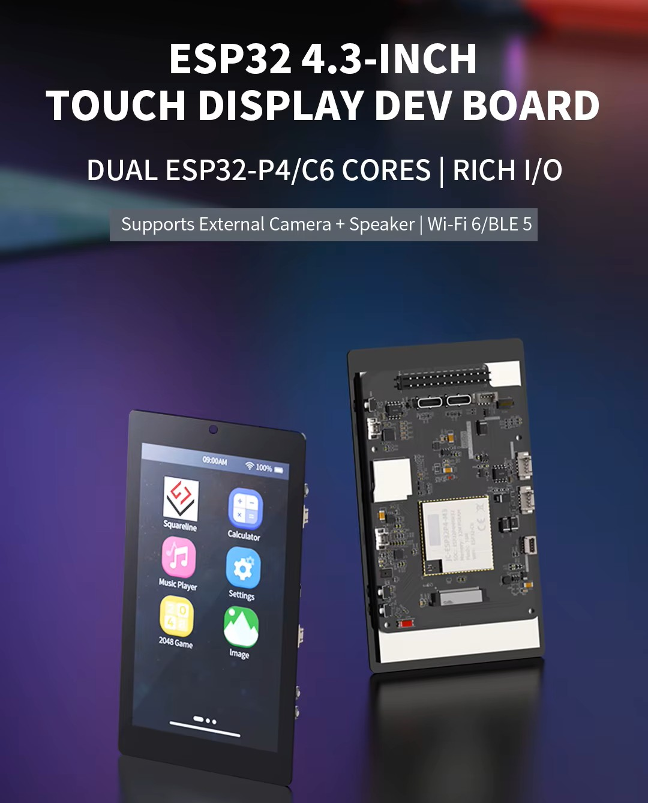</td>
    <td width="50%" align="center">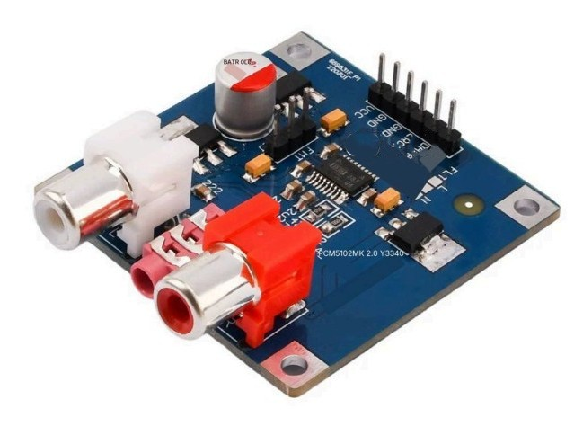</td>
  </tr>
  <tr>
    <td align="center">
      <sub>Guition JC4880P443C_I_W touchscreen board</sub><br>
      <a href="https://s.click.aliexpress.com/e/_c31cHQKD"><sub>[AliExpress]</sub></a>
    </td>
    <td align="center">
      <sub>PCM5102A stereo RCA DAC</sub><br>
      <a href="https://s.click.aliexpress.com/e/_c3rru3vP"><sub>[AliExpress]</sub></a>
    </td>
  </tr>
  <tr>
    <td align="center">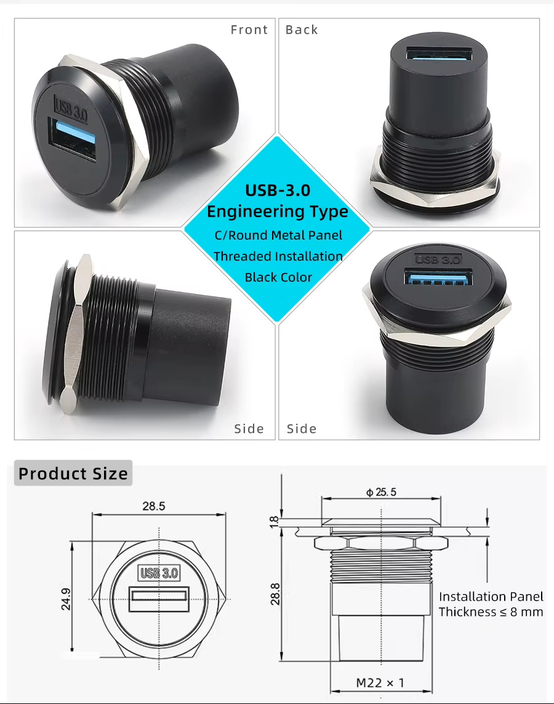</td>
    <td align="center">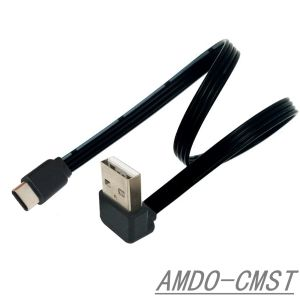</td>
  </tr>
  <tr>
    <td align="center">
      <sub>Panel-mount USB-A socket for the Rekordbox drive</sub><br>
      <a href="https://s.click.aliexpress.com/e/_c3xWR5DP"><sub>[AliExpress]</sub></a>
    </td>
    <td align="center">
      <sub>Board-to-panel USB cable</sub><br>
      <a href="https://s.click.aliexpress.com/e/_c3jC7GFX"><sub>[AliExpress]</sub></a>
    </td>
  </tr>
  <tr>
    <td align="center">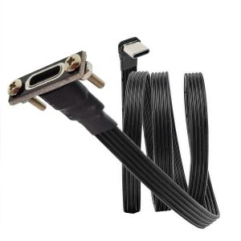</td>
    <td align="center">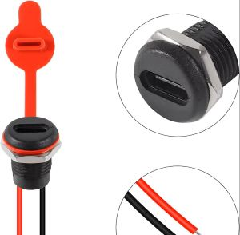</td>
  </tr>
  <tr>
    <td align="center">
      <sub>Panel-mount USB-C OTG lead for the DDJ-FLX4</sub><br>
      <a href="https://s.click.aliexpress.com/e/_c3fyaSjJ"><sub>[AliExpress]</sub></a>
    </td>
    <td align="center">
      <sub>Panel-mount USB-C power input</sub><br>
      <a href="https://s.click.aliexpress.com/e/_c4a9xDsN"><sub>[AliExpress]</sub></a>
    </td>
  </tr>
</table>

These are reference photos of the parts used in the build. Seller revisions
and cable pinouts can vary; verify every part electrically and follow the
wiring documentation rather than relying on product photos.

> [!CAUTION]
> USB0 and USB1 must receive safe, current-limited 5 V power. Isolate the
> native P4-side VBUS conductors before injecting protected downstream VBUS.
> Never combine independent supplies with a passive Y-cable. Read the complete
> [hardware wiring and electrical acceptance guide](docs/HARDWARE_WIRING.md)
> before building or changing the power wiring.

## Connect the system

### JC4880 reference build

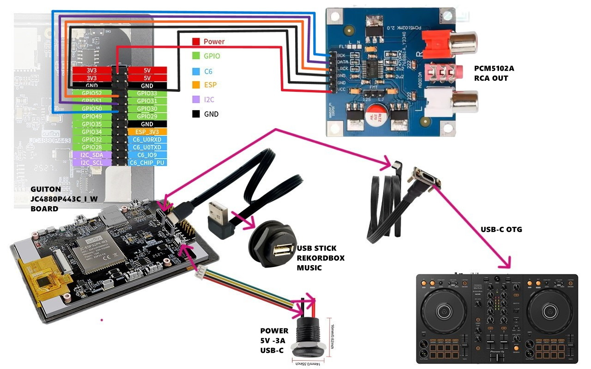

1. With power off, connect the regulated system supply and common ground as
   shown above.
2. Insert the Rekordbox USB drive into **USB0**.
3. Connect the DDJ-FLX4 to **USB1** using the USB-C OTG connection.
4. Connect the PCM5102A RCA output to the MAIN amplifier or powered speakers.
5. Connect headphones to the DDJ-FLX4 if cue monitoring is required.
6. Power on the system and wait for the Library to appear.
7. Browse a track, load it to D1 or D2, and press Play on the controller.

Both USB insertion orders and reconnect recovery have been physically tested.
For connector details and electrical limits, use
[`docs/HARDWARE_WIRING.md`](docs/HARDWARE_WIRING.md) as the source of truth.

### Other boards

For ordinary M3, USB1 supplies power/debug, FLX4 connects to USB2 FS and the
Rekordbox drive to USB3 HS. PCM5102A BCK/LCK/DIN use GPIO1/2/3, with SCK grounded
and shared ground. Preserve the accepted DSI506/FT5426 settings. The first
transition from historical M3 `main-deck-p4` requires the
[preserving wired migration](docs/M3_SHARED_CORE_MIGRATION.md), not cross-board OTA.

JC1060 uses USB0 for the controller and USB1 for storage, controller USB audio
for MAIN/cue, and its own display/touch/Ethernet provider. Do not enable the
JC4880/M3 PCM5102A pins on JC1060; they conflict with Ethernet. Follow the
[contributor handoff](docs/JC1060_BETA_HANDOFF_20261011.md) before installation.

## Touchscreen and controller workflow

- **Overview** shows both deck waveforms, transport state, time, BPM, pitch,
  Master Tempo and the active Beat FX.
- **Library** browses the Rekordbox USB collection and loads tracks to either
  deck.
- **Hot Cues** displays and manages performance cue points.
- **Settings** controls device options, diagnostics and Wi-Fi Remote.
- The DDJ-FLX4 controls transport, jog/vinyl, tempo, mixer/EQ, cue, loops,
  Beat Jump, Sync, pads and effects, with LED state restored after reconnect.

The screensaver consumes the first controller action to wake the display;
the second PLAY starts playback. Touch wake does not activate the control below
the screensaver. LOAD LOCK refuses replacing a playing deck, including shifted
LOAD; stop the deck before loading another track.

## Wi-Fi Remote and updates

Wi-Fi Remote is available on all three boards. Ordinary M3 starts with Wi-Fi
enabled (`Pajoniiir-M3`); JC1060 defaults OFF (`Pajoniiir-JC1060`) and retains
Ethernet management. Use the AP name shown in Settings. JC1060's Wi-Fi switch
is independent of Ethernet DJ LINK; Link remains Ethernet-only. This newer
candidate requires its own physical acceptance before broader support claims.

1. Enable **Wi-Fi Remote** on the Settings screen.
2. Connect a phone or computer to the `Pajoniiir` Wi-Fi network. The default
   WPA password is `Pajoniiir`.
3. Open [`http://192.168.4.1`](http://192.168.4.1) or
   [`http://pajoniiir.local`](http://pajoniiir.local).

For a JC4880 local update, upload only the signed `main-deck-p4.ddjota` package. Keep
power stable, stop playback and wait for the device to reboot completely.
Remote stable releases are published through `https://ota.pajoniiir.eu`.
JC1060 and M3 require `main-deck-jc1060.ddjota` and `main-deck-m3.ddjota`
respectively. The beta does not update any public pull channel. Never upload a
raw BIN through the signed OTA endpoint or select a different board's package.

See the [OTA update procedure](docs/OTA-UPDATE.md) for installation,
verification, rollback and wired-recovery instructions.

## Gallery

<table>
  <tr>
    <td width="50%">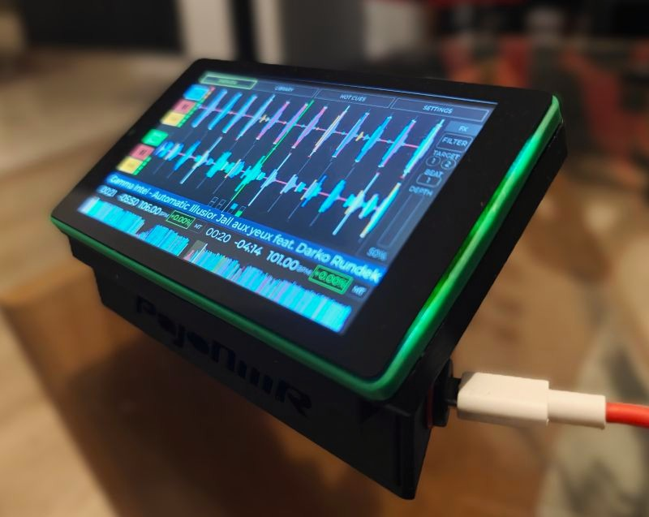</td>
    <td width="50%">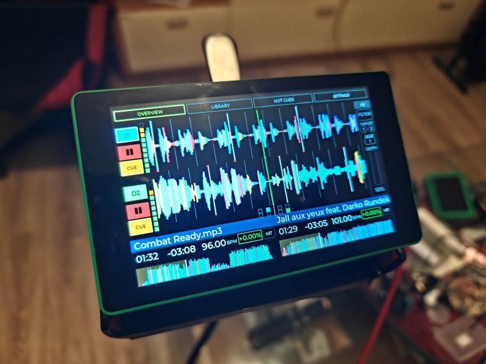</td>
  </tr>
  <tr>
    <td align="center"><sub>Compact standalone player and touchscreen</sub></td>
    <td align="center"><sub>Dual-deck Overview during playback</sub></td>
  </tr>
  <tr>
    <td colspan="2">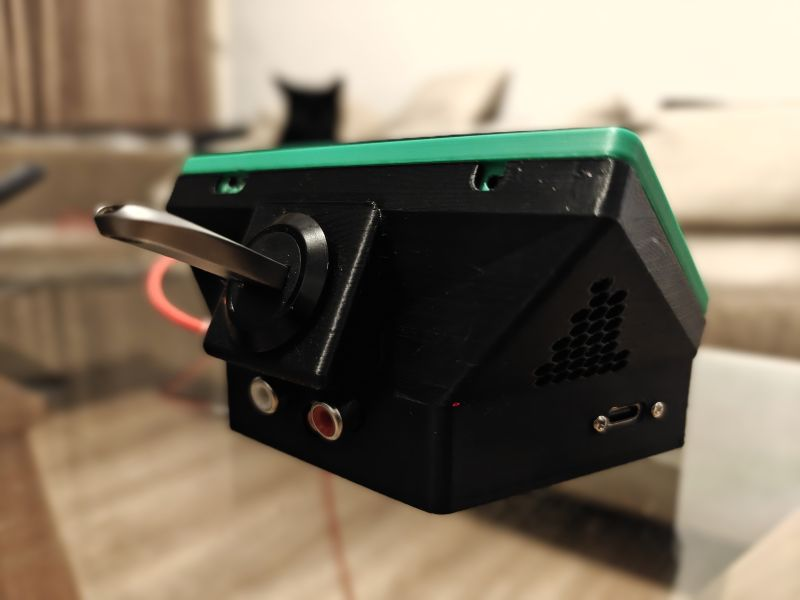</td>
  </tr>
  <tr>
    <td colspan="2" align="center"><sub>Enclosure connections and ventilation</sub></td>
  </tr>
</table>

## Demo video

[](https://youtu.be/3RuC3cYCGyE)


## 3D-print enclosure

The printable enclosure and assembly references are stored in
[`misc/`](misc/):

- [`PajoniiirCASE.stl`](misc/PajoniiirCASE.stl) — binary STL ready for slicer
  preparation;
- [`case_anim.gif`](misc/case_anim.gif) — exploded assembly animation;
- `case_assembe.png`, `case_assembe2.png` and `case1.jpg` — assembly and case
  reference views.

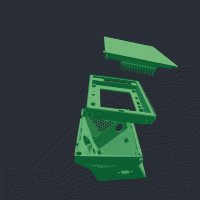

Confirm dimensions, orientation, supports and material settings in your slicer
before printing.

## Shared core and development

All three entrypoints link the same production audio, deck, Rekordbox,
controller, UI, web and OTA modules in `firmware/p4-core`. Peripheral providers
and product policies live under `firmware/boards`; independent protocols remain
in `firmware/common`. Dependency versions stay pinned to ESP-IDF **6.0.2**.

The shared core includes:

- PDB/ANLZ metadata corrections, playlist/folder catalogs, artwork workers,
  color waveforms, memory cues/loops and persistent media identities.
- Source/local Hot Cue merging with slot overrides, deletion tombstones and
  restore-source behavior. Legacy track-ID-only cues require explicit migration.
- Shared seek/preroll/loop handling, CUE/PLAY semantics and default-ON LOAD LOCK
  across MIDI, touch and web, including asynchronous load admission.
- M3 FIR/search-cache and consumer-owned PCM timeline fixes, plus board-specific
  waveform scheduling without a second playback implementation.
- S3CP v2/v3/v4 controller profiles, connection epochs, held-state reconciliation,
  LED feedback and descriptor-driven audio admission using the selected USB root.
- Board/project/source identity checks, signed OTA startup health/rollback,
  bounded journals and crash diagnostics.

Local three-target builds, board/component/lock/image-budget checks and the full
required-fixture host qualification passed on `722bb976`. Product UI simulator
results and unchanged-source equivalence are recorded in the
[final software matrix](docs/validation/SHARED_P4_FINAL_BUILD_MATRIX_20261011.md).
Hosted CI and wider real-media/controller/physical coverage retain their explicit
dispositions. Output-late observations remain monitoring findings, not zero-late
claims. Recorder, alternate DJ UI and M3 Ethernet/Pro DJ Link remain experimental
or disabled in ordinary builds.

Use the [final handoff](docs/reviews/2026-10-11-shared-core-final-handoff.md),
[integration ledger](docs/SHARED_P4_CORE_INTEGRATION.md),
[board policies](docs/SHARED_P4_BOARDS.md),
[JC1060 contributor handoff](docs/JC1060_BETA_HANDOFF_20261011.md) and
[beta delivery record](docs/validation/SHARED_P4_BETA_1_20261011.md) for exact
versions, installation boundaries and remaining gates.

## Build from source

ESP-IDF **v6.0.2** is required.

```powershell
. C:\Espressif\tools\Microsoft.v6.0.2.PowerShell_profile.ps1
idf.py --version  # must report ESP-IDF v6.0.2

$repoRoot = git rev-parse --show-toplevel
Set-Location "$repoRoot\firmware\main-deck-p4"
idf.py build
```

Select `firmware/main-deck-jc1060` or `firmware/main-deck-m3` instead for the
other products. Use a fresh build directory and SDKCONFIG per target/experiment;
do not reuse a role-swap configuration for an ordinary M3 release.

Run the same P4 host regression suite used by CI:

```powershell
Set-Location $repoRoot
$env:Path = "$env:Path;C:\msys64\ucrt64\bin"
.\tests\run_p4_host_tests.ps1 -Qualification
```

Run the headless UI screenshot and navigation gate:

```powershell
.\tests\ui_simulator\run_ui_simulator_e2e.ps1
```

Generated build directories, local `sdkconfig` files, signing keys and release
packages are intentionally excluded from Git. The reproducible dependency locks
for all three product entrypoints are committed; builds must not change them.

## Project status and documentation

The stable JC4880/FLX4 M2.5 release remains available. The shared P4 beta is a
separate contributor prerelease, with JC1060 physical checks deferred and JC4880
long soak explicitly skipped by the operator. DDJ-400/Pro DJ Link and broader
controller/real-media qualification retain their development limits. Current
status and acceptance limits are maintained in the
[final handoff](docs/reviews/2026-10-11-shared-core-final-handoff.md),
[documentation status](docs/DOCUMENTATION_STATUS.md) and
[development plan](docs/DEVELOPMENT_PLAN.md).

The [JC1060 selective integration](docs/reviews/2026-10-14-jc1060-selective-integration.md)
adds DDJ-400 loop controls and regression-backed shared USB/audio/startup repairs.
It is a local software candidate; JC1060 hardware and SD warm-reset gates remain
open, and published beta assets retain their original identity.

- [Online user manual](https://docs.pajoniiir.eu/)
- [Project overview](docs/PROJECT_OVERVIEW.md)
- [Architecture](docs/ARCHITECTURE.md)
- [Hardware wiring](docs/HARDWARE_WIRING.md)
- [Startup and release checklist](docs/STARTUP_CHECKLIST.md)
- [FLX4 MIDI map](docs/DDJ_FLX4_MIDI_MAP.md)
- [OTA update procedure](docs/OTA-UPDATE.md)
- [Security and provisioning policy](docs/SECURITY_PROVISIONING_POLICY.md)
- [Development plan](docs/DEVELOPMENT_PLAN.md)
- [Risk register](docs/RISK_REGISTER.md)

The JC4880, JC1060 and M3 entrypoints are `firmware/main-deck-p4`,
`firmware/main-deck-jc1060` and `firmware/main-deck-m3`. All use one shared
P4 core. Historical S3 and dual-processor material remains in Git history and
is not part of the active product.

## License

Pajoniiir is available under the [MIT License](LICENSE).
